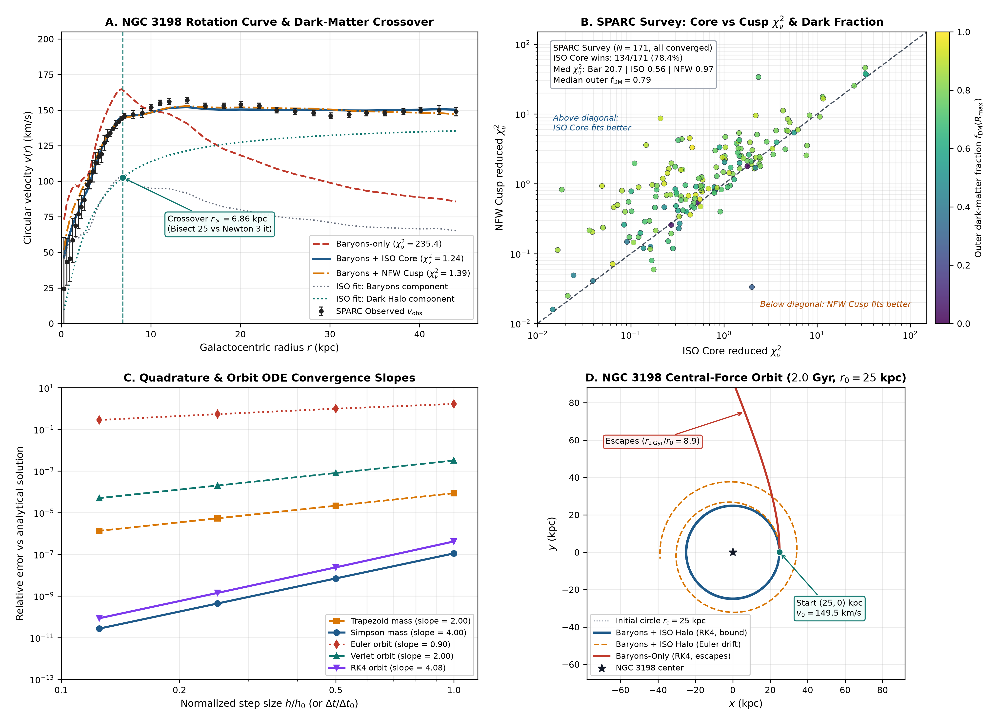

# sparc-dm

Dark-matter halo rotation-curve modeling, numerical quadrature, nonlinear optimization, and central-force NGC 3198 orbit integration using the 175-galaxy [SPARC database](http://astroweb.cwru.edu/SPARC/) (171 galaxies with at least five radial measurements analyzed in the survey).



## Quickstart

```bash
pip install -e ".[dev]"
sparc-dm                               # runs full SPARC survey -> outputs/sparc_results.json
pytest                                 # runs automated numerical & physics verification tests
python verification/verify_and_plot.py # generates 4-panel summary -> outputs/sparc_summary.png
```

## Architecture

For an axisymmetric disk galaxy embedded in a spherical dark-matter halo, the circular rotation velocity satisfies:

$$v_{\mathrm{tot}}^2(r) = v_{\mathrm{gas}}(r)|v_{\mathrm{gas}}(r)| + \Upsilon_d\, v_{\mathrm{disk}}^2(r) + \Upsilon_b\, v_{\mathrm{bul}}^2(r) + \frac{G M_{\mathrm{DM}}(r)}{r}, \qquad M_{\mathrm{DM}}(r) = \int_0^r 4\pi r'^2 \rho_{\mathrm{DM}}(r')\,dr'$$

with $G = 4.30091 \times 10^{-6}\text{ kpc (km/s)}^2\,M_\odot^{-1}$. All numerical quadrature, root-finding, optimization, and orbit integration routines in `src/sparc_dm/` are implemented in Python and NumPy.

| Module | Description |
| :--- | :--- |
| `src/sparc_dm/data.py` | Parses SPARC `*_rotmod.dat` profiles into `GalaxyData` records. |
| `src/sparc_dm/models.py` | Pseudo-Isothermal core and NFW cusp profiles, baryonic velocity composition, and reduced $\chi^2$. |
| `src/sparc_dm/integrators.py` | Trapezoid, Simpson ($O(h^4)$), Gauss–Legendre quadrature, and cumulative radial mass integration. |
| `src/sparc_dm/solvers.py` | Bisection, safeguarded Newton–Raphson, Brent 1D, projected Polak–Ribière+ CG halo fitting, and crossover radii. |
| `src/sparc_dm/orbits.py` | 2D galactic test-particle ODE solvers (Euler, RK4, Velocity Verlet) and conservation diagnostics. |
| `src/sparc_dm/cli.py` | End-to-end 171-galaxy SPARC survey, NGC 3198 / DDO 154 cases, spherical-equivalent NGC 3198 orbit test, and JSON report (`outputs/sparc_results.json`). |
| `src/sparc_dm/guards.py` | Input validation, small-$r$ Taylor series, overflow safeguards, and box-bound helpers. |
| `verification/verify_and_plot.py` | Convergence checks and 4-panel summary figure generator (`outputs/sparc_summary.png`). |
